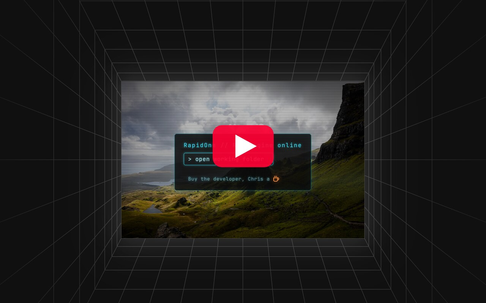

# RapidOne – RAW Editor for the future

A RAW photo editor for working photographers: cull, edit and retouch a whole shoot in one
app, entirely on your own computer. No uploads, no accounts, no subscription. Edits are
non-destructive and the RAW files are never changed.

Part of a family of apps by Chris Cork Photography: RapidOne brings
[RapidCulling](https://github.com/crispin81/RapidCulling) and
[RapidRetouch](https://github.com/crispin81/RapidRetouch) together with a new RAW editor.

> **Actively developed: expect frequent updates.**

**New to RapidOne? Watch the videos:**

[](https://www.youtube.com/playlist?list=PLC5lWfy1MHI8)

## Download

**[⬇ Download the latest version](https://github.com/crispin81/RapidOne/releases/latest)**

| | |
|---|---|
| **Linux** | [AppImage](https://github.com/crispin81/RapidOne/releases/latest/download/RapidOne_linux_x86_64.AppImage) (any recent distribution) · [.deb](https://github.com/crispin81/RapidOne/releases/latest/download/RapidOne_linux_amd64.deb) (Ubuntu, Mint, Pop!_OS, Debian) |
| **Windows** | Coming soon |
| **Mac** (Apple Silicon) | Coming soon |

## Installing on Linux

Works on Ubuntu 24.04 or newer, Linux Mint 22, Pop!_OS 24.04, Fedora 40+, Debian 13, Arch,
Omarchy, EndeavourOS, openSUSE Tumbleweed and other recent distributions (64-bit). Older
releases such as Ubuntu 22.04 aren't supported.

**AppImage** (any distribution): make it executable, then run it:

```sh
chmod +x RapidOne_linux_x86_64.AppImage
./RapidOne_linux_x86_64.AppImage
```

On **Ubuntu 24.04 and newer** an AppImage needs FUSE 2, which isn't installed by default.
If it doesn't start, install it once:

```sh
sudo apt install libfuse2t64
```

To have RapidOne in your applications menu with its icon, open the AppImage with
[Gear Lever](https://flathub.org/apps/it.mijorus.gearlever) or AppImageLauncher, which add
it for you.

**.deb** (Ubuntu, Mint, Pop!_OS, Debian): installs RapidOne with a menu entry and icon, and
uninstalls cleanly. No FUSE needed:

```sh
sudo apt install ./RapidOne_linux_amd64.deb
```

**If the window comes up blank or the app closes straight away** (some graphics drivers),
start it once in safe drawing mode, which is slower but works everywhere:

```sh
RAPIDONE_SAFE_DRAWING=1 ./RapidOne_linux_x86_64.AppImage
```

**Culling from your phone:** if your phone can't find the computer, your firewall may be
blocking it. Allow ports 47811–47850 on your home network, for example with ufw:

```sh
sudo ufw allow from 192.168.0.0/16 to any port 47811:47850 proto tcp
```

**First time you open Retouch**, it downloads its AI engine once (about 3 GB with an NVIDIA
graphics card, about 1 GB otherwise) and shows its progress. Edit's AI tools are already
in the download and work offline straight away.

These builds aren't code-signed yet, so your system may warn that the publisher is
unverified. That's expected, not a sign anything's wrong.

## What it does

Three tabs, one folder of photos:

- **Cull**: pick and rate a shoot fast, with near-duplicates grouped (from RapidCulling),
  and cull from your phone on the same Wi-Fi.
- **Edit**: RapidOne's own RAW engine.
  - White balance, tone (Exposure, Contrast, Highlights, Shadows, Whites, Blacks),
    Texture, Clarity, Dehaze, Vibrance, Saturation, tone curves, colour Mixer, colour
    grading wheels, sharpening, vignette and grain.
  - Crop and straighten, auto level and keystone, lens corrections (Lensfun).
  - Masks: Subject (automatic), Brush, Linear and Radial, combined and inverted.
  - Erase: drag a box or paint over an object to remove it, or find it by name.
    Patch: Heal or Clone, Photoshop-style.
  - AI Denoise, also "Denoise all" for every photo above a chosen ISO.
  - Lightroom compatible: reads Lightroom and Aftershoot XMP edits, including crops and
    gradients, and uses Adobe's camera profiles if you add your own.
  - Teach a look: learn your white balance and exposure from your own edited photos, then
    apply your style to a whole shoot. Presets, copy/paste and before/after.
  - Export to JPEG or 16-bit TIFF, full size or scaled, with export presets.
- **Retouch**: AI-assisted portrait retouching (from RapidRetouch): skin, eyes, mouth,
  backdrop, dodge & burn and more, on the edited photo.

Photos never leave your computer.

## AI models

Only permissively licensed models are used, because the people using this do paid client
work. Edit's models come in the download.

| Model | Used for | Licence |
|---|---|---|
| BiRefNet lite | Subject mask | MIT |
| LaMa | Erase (fill) | Apache-2.0 |
| MobileSAM | Outlining objects to erase | MIT |
| Grounding DINO tiny | Finding objects by name | Apache-2.0 |
| RapidOne denoise (distilled from SCUNet) | AI Denoise | Apache-2.0 |

Retouch's models are listed in [RapidRetouch](https://github.com/crispin81/RapidRetouch#ai-models).

## How it's built

- **App:** Tauri 2 + React + TypeScript (`src/`), with the RAW engine in Rust
  (`src-tauri/src/`).
- **Cull** and **Retouch** are the RapidCulling and RapidRetouch apps, embedded as modules.
- AI models run with ONNX Runtime: on the graphics card where it can (WebGPU on Linux,
  DirectML on Windows, CoreML on a Mac), otherwise on the processor.

## Licence

[AGPL-3.0-only](LICENSE). Copyright Chris Cork.

Lens data from [Lensfun](https://lensfun.github.io/) (CC BY-SA 3.0).

If you find it useful: [buy me a coffee](https://buymeacoffee.com/chriscorkphotography).
· [chriscorkphotography.co.uk](https://www.chriscorkphotography.co.uk)
